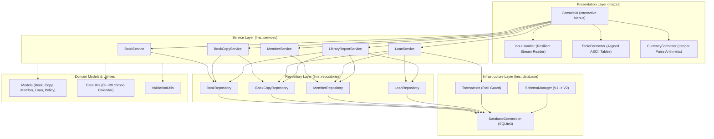
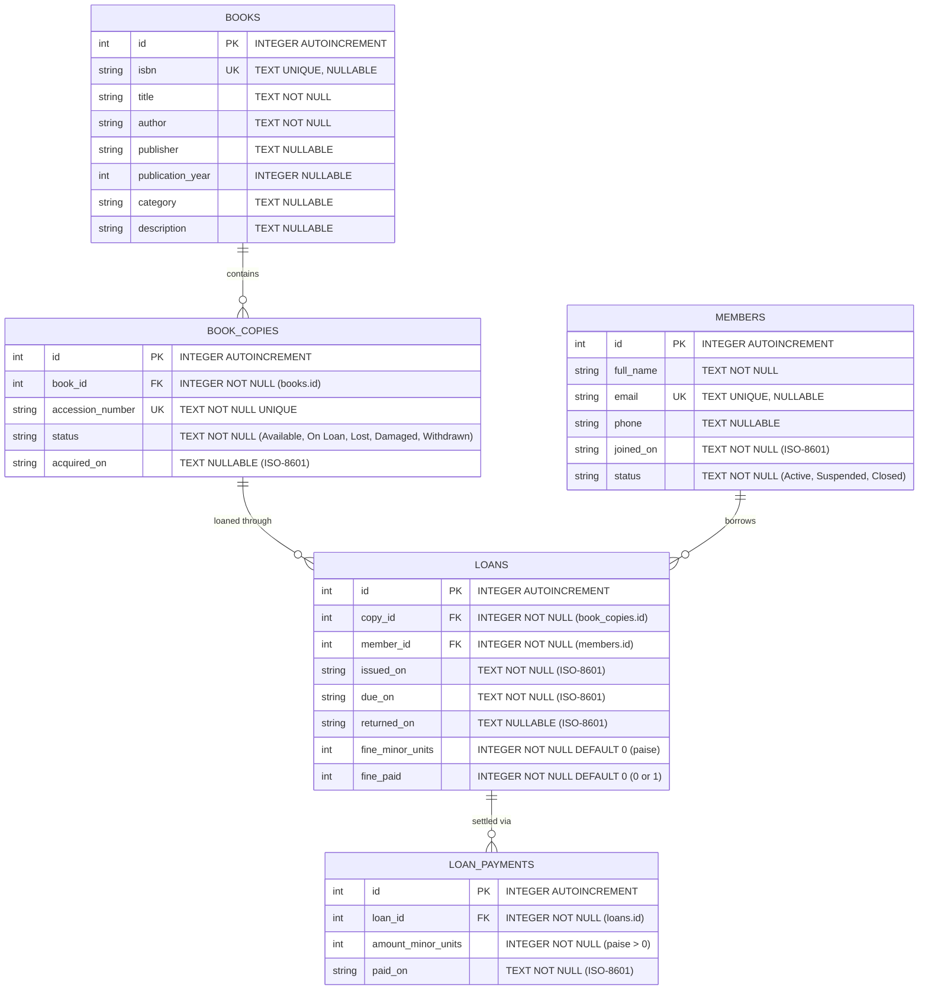

# Library Management System

A high-performance, robust, and professional Library Management System built with modern **C++20**, **SQLite3**, **CMake**, and **GoogleTest**.

[](https://github.com/ThunderSkull7/library-management-system/actions/workflows/ci.yml)


The application provides an enterprise-ready circulation and catalog management engine designed for physical libraries. It enforces strict physical copy tracking, patron account status lifecycles, atomic circulation checkouts and returns, thread-safe database concurrency, exact integer paise fine accounting, flexible search queries, administrative reporting, and an interactive, resilient console interface.

---

## 1. Key Features

- **Book Catalog & Physical Copy Tracking**: Distinct domain separation between bibliographic titles (`Book`) and specific inventory items (`BookCopy`) with barcode/accession numbers and physical statuses (`Available`, `On Loan`, `Lost`, `Damaged`, `Withdrawn`).
- **Patron Account Lifecycles**: Registered members with unique email addresses, contact details, join dates, and account states (`Active`, `Suspended`, `Closed`).
- **Atomic Circulation Workflows**: Checkout and return operations execute within strict `BEGIN IMMEDIATE` transactions, updating loans and physical copy statuses atomically to eliminate race conditions.
- **Accurate Financial Accounting (Zero Floating-Point Drift)**: Fines and fine payments are calculated and stored strictly in integer minor units (paise: ₹1 = 100 paise; ₹2.00/day default). Fines remain immutable once assessed, and split partial payments are reliably aggregated.
- **Calendar & Overdue Calculations**: Powered by C++20 `<chrono>` calendar algorithms (`year_month_day`), safely computing loan durations, leap years, month boundaries, grace periods, and maximum fine caps.
- **Comprehensive Administrative Reports**: Five instant analytical reports:
  1. *Catalog Inventory Summary* (counts by title and physical status).
  2. *Circulation Summary* (with optional ISO date-range filters).
  3. *Member Activity Report* (status breakdown and ranked top borrowers).
  4. *Financial & Fine Report* (total assessed, collected revenue, net outstanding balance).
  5. *Overdue Loans Report* (active overdue loans with days overdue and accrued fines evaluated as of any date).
- **Interactive & Resilient CLI**: Clean menu hierarchy, breadcrumbs, automatic whitespace trimming, stream recovery on malformed numeric input, and graceful exit on `EOF` (`Ctrl+Z`).
- **Production-Grade SQLite Engine**: RAII connection lifecycle management, automated busy timeouts (5,000 ms), foreign key enforcement (`PRAGMA foreign_keys = ON;`), and migration tracking (`PRAGMA user_version`).

---

## 2. Application Terminal Preview

*Illustrative terminal output from an actual session of the compiled CLI application:*

```text
========================================
  LIBRARY MANAGEMENT SYSTEM
========================================
1. Book Management
2. Physical Copy Management
3. Member Management
4. Issue / Return Books
5. Search
6. Reports
7. Fine Payments
0. Exit

Select an option: 4

========================================
  ISSUE / RETURN BOOKS
========================================
1. Issue a Book Copy to Member
2. Return a Book Copy
0. Back to Main Menu

Select an option: 1

--- Issue Book Copy to Member ---
Enter Member ID: 1
Borrower: Katherine Johnson (Active)
Enter Copy ID: 1
Copy: #DDD-COPY-01 - "Domain-Driven Design"
Issue Date [2026-11-04]: 2026-01-05

[✓] Book successfully checked out!
=======================================================
 Loan ID      : 1
 Member       : Katherine Johnson (ID #1)
 Book         : "Domain-Driven Design"
 Copy Barcode : DDD-COPY-01 (Copy #1)
 Issued On    : 2026-01-05
 Due Date     : 2026-01-19
=======================================================
```

*Financial settlement and ASCII tabular reporting preview:*

```text
========================================
  FINANCIAL & FINE REPORT
========================================
 Total Fines Assessed     : ₹20.00
 Total Payments Received  : ₹20.00
 Outstanding Balance      : ₹0.00
----------------------------------------
 Unpaid Fine Records      : 0
 Fully Paid Fine Records  : 1
========================================

+------------+----------------+----------------+
| Payment ID |    Amount Paid | Payment Date   |
+------------+----------------+----------------+
|          1 |          ₹8.00 | 2026-01-30     |
|          2 |         ₹12.00 | 2026-01-31     |
+------------+----------------+----------------+
```

---

## 3. Technology Stack

| Layer / Aspect | Technology / Tool | Version / Standard |
|---|---|---|
| **Language Standard** | Modern C++ | **C++20** (`/std:c++20` with `/permissive- /utf-8 /W4`) |
| **Operating System** | Microsoft Windows | Windows 11 / Windows 10 (x64) |
| **Compiler Toolchain** | Microsoft Visual C++ (MSVC) | Visual Studio 2022 (MSVC v143) |
| **Build System** | CMake | Version 3.20+ with CMake Presets (V3) |
| **Dependency Manager** | vcpkg | Manifest mode (`vcpkg.json`) |
| **Database Engine** | SQLite3 | Version 3.45+ (via vcpkg) |
| **Test Framework** | GoogleTest (gtest) | Version 1.14+ (via CTest) |
| **Continuous Integration** | GitHub Actions | Windows Server 2022 Hosted Runner (`windows-latest`) |

---

## 4. Architecture Overview

The system is constructed with strict horizontal layering, decoupling user presentation, business logic, data persistence, and database connection infrastructure.



*For comprehensive architecture specifications, see [docs/architecture.md](docs/architecture.md).*

---

## 5. Database Design

The database schema enforces data integrity through foreign keys with `ON DELETE RESTRICT`, column constraints, and a partial unique index ensuring that a physical copy cannot be loaned simultaneously to multiple patrons.



*For complete schema DDL, indexing strategies, and migration history, see [docs/database_architecture.md](docs/database_architecture.md).*

---

## 6. Build and Installation Instructions

### Prerequisites
- **Visual Studio 2022** (v17.0+) with the "Desktop development with C++" workload (MSVC toolchain v143).
- **CMake** (v3.20 or newer).
- **vcpkg** package manager. Set the environment variable `VCPKG_ROOT` (e.g. `C:\vcpkg`).
- **Git** for version control.

### Step 1: Clone Repository
```powershell
git clone https://github.com/ThunderSkull7/library-management-system.git
cd library-management-system
```

### Step 2: Configure Environment
Ensure `VCPKG_ROOT` is configured in your shell:
```powershell
$env:VCPKG_ROOT = "C:\vcpkg"
```

### Step 3: Configure via CMake Presets
vcpkg manifest mode will automatically download, compile, and link SQLite3 and GoogleTest:

```powershell
# Debug Configuration
cmake --preset windows-msvc-debug

# Release Configuration
cmake --preset windows-msvc-release
```

### Step 4: Build Executables & Test Suites
```powershell
# Compile Debug Targets
cmake --build --preset windows-msvc-debug

# Compile Release Targets
cmake --build --preset windows-msvc-release
```

---

## 7. Running the Application

Execute the compiled application binary from your terminal:

```powershell
# Run Release Executable (manages data/library.db by default)
.\build\release\Release\library_management_system.exe
```

### Custom Database Path
The executable optionally accepts a custom database file path:
```powershell
.\build\release\Release\library_management_system.exe path\to\my_branch_library.db
```

Upon startup, the database directory is verified, foreign keys and busy timeouts are configured, and migrations are applied automatically.

---

## 8. Running Automated Tests

Run the complete test suite across all 214 GoogleTests using CTest:

```powershell
# Run Debug Tests with Failure Reporting
ctest --preset windows-msvc-debug --output-on-failure

# Run Release Tests with Failure Reporting
ctest --preset windows-msvc-release --output-on-failure
```

You can also run the test executable directly:
```powershell
.\build\release\tests\Release\library_management_tests.exe
```

*For exact test case matrices and workflow logs, see [docs/testing_and_verification.md](docs/testing_and_verification.md).*

---

## 9. Example Workflows

### Workflow A: Book Creation, Copies & Member Checkout
1. Select `1. Book Management` -> `1. Add a Book`. Enter title, author, optional ISBN, publisher, and category.
2. Select `2. Physical Copy Management` -> `1. Add a Physical Copy`. Enter Book ID, accession barcode (e.g. `ACC-001`), and initial status (`Available`).
3. Select `3. Member Management` -> `1. Register a Member`. Enter patron full name, email, phone number, and join date.
4. Select `4. Issue / Return Books` -> `1. Issue a Book Copy to Member`. Enter Member ID, Copy ID, and Issue Date.
5. The system calculates the due date (14 days), marks the copy `On Loan`, and records the active loan.

### Workflow B: Safeguards & Rejection of Disallowed Checkouts
1. Attempt to check out an already-loaned copy: The system aborts with `Copy is not available for checkout (current status: On Loan)`.
2. Suspend a patron account (`3. Member Management` -> `5. Suspend / Reactivate / Close Member`).
3. Attempt checkout for the suspended patron: The system rejects the transaction with `Cannot checkout book to inactive member (current status: Suspended)`.
4. The database remains completely consistent without partial records.

### Workflow C: Overdue Return & Fine Assessment
1. Select `4. Issue / Return Books` -> `2. Return a Book Copy`.
2. Enter the Copy ID and a return date beyond the scheduled due date.
3. The system calculates overdue calendar days and assesses the fine in integer paise (₹2.00 / 200 paise per day):
   - *Example: 10 days overdue = 2000 paise = ₹20.00.*
4. The copy is safely marked `Available` for borrowing.

### Workflow D: Fine Settlement & Split Payments
1. Select `7. Fine Payments` -> `3. Record a Fine Payment`. Enter Loan ID.
2. The system displays assessed fine, prior payments, and outstanding balance.
3. Record a partial payment (e.g. 800 paise = ₹8.00). The balance decrements to ₹12.00, remaining `Partially Paid`.
4. Record the final payment (1200 paise = ₹12.00). The system marks the loan `FULLY SETTLED [✓]`.

---

## 10. Default Circulation Policy

Circulation policies are managed by the configurable domain model `LibraryPolicy`:

| Policy Parameter | Default Value | Description |
|---|---|---|
| **Standard Loan Duration** | 14 calendar days | Lending period for checked-out physical copies |
| **Overdue Fine Rate** | 200 paise / day (`₹2.00`) | Accrued per overdue day past the scheduled due date |
| **Borrowing Limit** | 5 active loans | Maximum concurrent active checkouts per patron |
| **Grace Period** | 0 calendar days | Buffer period past due date before fines begin accruing |
| **Maximum Fine Cap** | Uncapped (`std::nullopt`) | Configurable maximum ceiling on accumulated fine per loan |

---

## 11. Project Documentation Links

Deep architectural specifications, database designs, and verification logs are available in the `docs/` directory:

- [System Architecture](docs/architecture.md): Layered design, transaction boundaries, concurrency protections, and error handling.
- [Database Architecture](docs/database_architecture.md): Full schema specifications (V2), index optimizations, constraints, and migration history.
- [Testing & Verification Evidence](docs/testing_and_verification.md): Automated test matrix (214 tests) and end-to-end CLI workflow execution logs.

---

## 12. Future Improvements (Planned)

The following capabilities represent reasonable future extensions beyond the core single-machine CLI architecture:

- **Automated Patron Notifications**: Scheduled background sidecar generating reminder emails for approaching due dates.
- **Hardware Barcode Integration**: Direct USB/serial barcode scanner HID listener for rapid checkouts and returns.
- **Inter-Branch Inventory Transfers**: Multi-branch support tracking transit states between regional library branches.
- **Role-Based Staff Access**: Cryptographic authentication separating permissions for Librarians, Catalogers, and Auditors.

---

## 13. Project Directory Structure

```text
LibraryManagementSystem/
│
├── .github/
│   └── workflows/
│       └── ci.yml              # GitHub Actions CI workflow (MSVC Debug & Release)
│
├── CMakeLists.txt              # Root build configuration
├── CMakePresets.json           # Presets for Windows MSVC Debug & Release
├── vcpkg.json                  # Manifest dependencies (sqlite3, gtest)
├── .gitignore                  # Git ignore rules for build, runtime DB, and IDE artifacts
├── .clang-format               # Code formatting configuration
├── README.md                   # Project landing page
│
├── docs/
│   ├── architecture.md         # Detailed system architectural documentation
│   ├── database_architecture.md # Database schema, ER diagram & index design
│   └── testing_and_verification.md # Test evidence and CLI workflow execution logs
│
├── include/
│   ├── cli/
│   │   ├── ConsoleUI.hpp       # Interactive CLI menu orchestrator
│   │   ├── CurrencyFormatter.hpp # Integer paise currency formatter (₹X.XX)
│   │   ├── InputHandler.hpp    # Resilient user input reader and validator
│   │   └── TableFormatter.hpp  # Aligned ASCII tabular output renderer
│   ├── database/
│   │   ├── DatabaseConnection.hpp
│   │   ├── DatabaseException.hpp
│   │   ├── PreparedStatement.hpp
│   │   ├── SchemaManager.hpp
│   │   └── Transaction.hpp
│   ├── models/
│   │   ├── Book.hpp
│   │   ├── BookCopy.hpp
│   │   ├── BookCopyStatus.hpp
│   │   ├── LibraryPolicy.hpp
│   │   ├── Loan.hpp
│   │   ├── LoanPayment.hpp
│   │   ├── Member.hpp
│   │   ├── MemberStatus.hpp
│   │   └── ReportModels.hpp    # Domain DTOs for administrative reports
│   ├── repositories/
│   │   ├── BookCopyRepository.hpp
│   │   ├── BookRepository.hpp
│   │   ├── LoanRepository.hpp
│   │   └── MemberRepository.hpp
│   ├── services/
│   │   ├── BookCopyService.hpp
│   │   ├── BookService.hpp
│   │   ├── LibraryReportService.hpp # Reporting service for analytics
│   │   ├── LoanService.hpp
│   │   └── MemberService.hpp
│   └── utils/
│       ├── DateUtils.hpp
│       ├── ValidationException.hpp
│       └── ValidationUtils.hpp
│
├── src/
│   ├── main.cpp                # Application entry point with ConsoleUI launch
│   ├── cli/
│   │   ├── ConsoleUI.cpp
│   │   ├── InputHandler.cpp
│   │   └── TableFormatter.cpp
│   ├── database/
│   │   ├── DatabaseConnection.cpp
│   │   ├── SchemaManager.cpp
│   │   └── Transaction.cpp
│   ├── models/
│   │   ├── Book.cpp
│   │   ├── BookCopy.cpp
│   │   ├── BookCopyStatus.cpp
│   │   ├── LibraryPolicy.cpp
│   │   ├── Loan.cpp
│   │   ├── LoanPayment.cpp
│   │   ├── Member.cpp
│   │   └── MemberStatus.cpp
│   ├── repositories/
│   │   ├── BookCopyRepository.cpp
│   │   ├── BookRepository.cpp
│   │   ├── LoanRepository.cpp
│   │   └── MemberRepository.cpp
│   ├── services/
│   │   ├── BookCopyService.cpp
│   │   ├── BookService.cpp
│   │   ├── LibraryReportService.cpp
│   │   ├── LoanService.cpp
│   │   └── MemberService.cpp
│   └── utils/
│       ├── DateUtils.cpp
│       └── ValidationUtils.cpp
│
├── tests/
│   ├── CMakeLists.txt          # Test build configuration
│   ├── test_book_copy_repository.cpp
│   ├── test_book_copy_service.cpp
│   ├── test_book_model.cpp
│   ├── test_book_repository.cpp
│   ├── test_book_service.cpp
│   ├── test_cli_helpers.cpp    # CLI InputHandler, TableFormatter, CurrencyFormatter
│   ├── test_database_connection.cpp
│   ├── test_date_utils.cpp
│   ├── test_library_policy.cpp
│   ├── test_loan_model.cpp
│   ├── test_loan_repository.cpp
│   ├── test_loan_service.cpp
│   ├── test_member_model.cpp
│   ├── test_member_repository.cpp
│   ├── test_member_service.cpp
│   ├── test_report_service.cpp # Reports & end-to-end workflow verification
│   ├── test_schema_manager.cpp
│   └── test_transaction.cpp
│
└── data/
    └── .gitkeep                # Application runtime database directory
```
