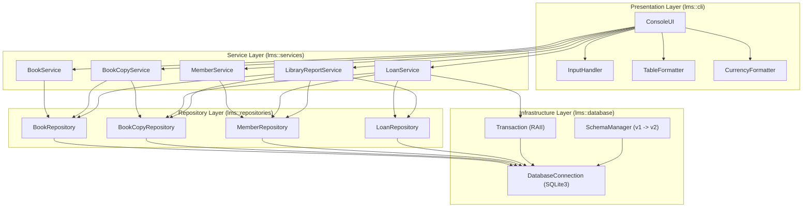
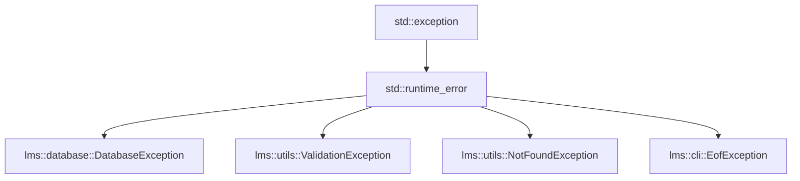

# System Architecture — Library Management System

## 1. Overview & Architectural Style

The Library Management System is built using a clean, layered architectural pattern in modern **C++20**. It prioritizes type safety, memory safety, transaction isolation, deterministic resource management (RAII), and robust operational integrity.

The system is strictly decomposed into four horizontal layers:
1. **Presentation / CLI Layer (`lms::cli`)**: Interactive menus, breadcrumbs, resilient console input readers (`InputHandler`), formatted ASCII tables (`TableFormatter`), and currency display (`CurrencyFormatter`).
2. **Service / Business Layer (`lms::services`)**: Enforces library policy, loan limits, member eligibility, fine assessments, search orchestration, and administrative reporting.
3. **Repository / Data Access Layer (`lms::repositories`)**: Encapsulates SQL queries and prepared statement execution, translating raw database rows into strongly typed domain models.
4. **Database / Infrastructure Layer (`lms::database`)**: RAII SQLite connection lifecycle, transaction boundary management (`Transaction`), and schema migration (`SchemaManager`).

---

## 2. Layered Architecture Diagram

---

## 3. Core Design Decisions & Invariants

### 3.1 RAII Resource Management
Every system resource is owned by a concrete C++ object whose destructor guarantees proper cleanup:
- **`DatabaseConnection`**: Wraps the native `sqlite3*` handle. Destructor invokes `sqlite3_close_v2`. Copy semantics are deleted; move semantics use `std::exchange`.
- **`PreparedStatement`**: Wraps `sqlite3_stmt*`. Automatically finalizes upon destruction, preventing statement leaks.
- **`Transaction`**: RAII transaction guard. Automatically issues `ROLLBACK;` if destroyed before `commit()` is explicitly called.

### 3.2 Transaction Boundary & Concurrency Safety
In multi-step workflows like `checkoutBook`, `returnBook`, and `payFine`, database state must not change between validation checks and writes:
- **`BEGIN IMMEDIATE` before reads**: To prevent time-of-check to time-of-use (TOCTOU) race conditions, the service opens a `BEGIN IMMEDIATE` transaction *before* querying copy status, active loan counts, or outstanding fine balances.
- Any conflicting concurrent transaction is held until the timeout (5,000 ms) or aborted cleanly without leaving partial state.

### 3.3 Financial Correctness: Integer Minor Units
- Monetary calculations (overdue fines and fine payments) strictly use integer paise (minor units, 1 Rupee = 100 paise).
- Floating-point types (`float`, `double`) are completely avoided in financial accounting to prevent IEEE 754 precision loss.
- `CurrencyFormatter` converts paise into Indian Rupee strings (`₹X.XX`) strictly via integer arithmetic (`abs(paise) / 100` and `abs(paise) % 100`).

### 3.4 Date & Calendar Invariants
- All dates are formatted and stored as strict ISO-8601 strings (`YYYY-MM-DD`).
- Date parsing and calendar calculations (`addDays`, `daysBetween`, leap year verification) use C++20 `<chrono>` calendar types (`std::chrono::year_month_day`).
- Validation rejects non-existent dates (e.g. `2026-02-29` is invalid because 2026 is not a leap year).

### 3.5 Resilience & Stream Isolation
- `ConsoleUI` accepts `std::istream&` and `std::ostream&` via dependency injection, allowing deterministic end-to-end automation via `std::istringstream` and `std::ostringstream`.
- `InputHandler` clears `std::cin` fail states (`in.clear()`) and flushes bad tokens on error.
- End-of-file conditions (`in.eof()`, Ctrl+Z, Ctrl+D) throw `EofException`, allowing graceful shutdown without infinite loops.

---

## 4. Exception Hierarchy & Error Handling

- **`DatabaseException`**: Encapsulates SQLite engine failures, SQL syntax errors, and constraint violations with native error codes.
- **`ValidationException`**: Thrown on malformed inputs (invalid dates, duplicate ISBNs, blank names, loan limit violations).
- **`NotFoundException`**: Thrown when querying an entity ID that does not exist in the database.
- **`EofException`**: Raised by interactive CLI handlers when the input stream is closed unexpectedly.

