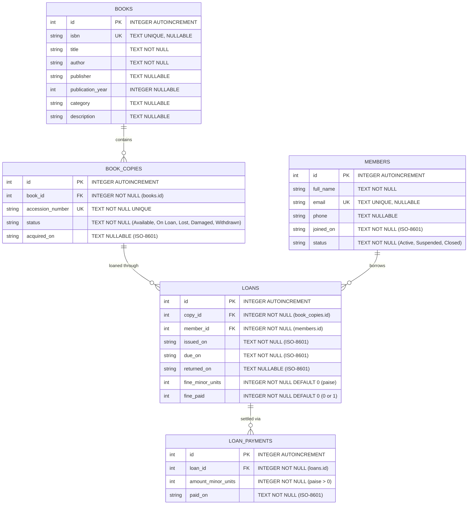

# Database Architecture — Library Management System

## 1. Overview

The Library Management System foundation employs an embedded **SQLite3** database accessed through an idiomatic, modern C++20 resource-management architecture.

The database layer is divided into two primary components:
1. **`DatabaseConnection`**: Responsible for database connection lifecycle management (RAII), runtime configuration, busy timeout handling (5,000 ms), and foreign-key constraint enforcement (`PRAGMA foreign_keys = ON;`).
2. **`SchemaManager`**: Responsible for transactional DDL execution, schema migration tracking via SQLite's `PRAGMA user_version`, idempotent table and index creation, and rejecting unsupported future versions.

---

## 2. Entity-Relationship Diagram



---

## 3. Database Schema Specification (Version 2)

### 3.1 Tables

#### A. `books`
Represents the bibliographic entity in the catalog.

| Column | Type | Constraints | Description |
|---|---|---|---|
| `id` | INTEGER | PRIMARY KEY AUTOINCREMENT | Unique book record identifier |
| `isbn` | TEXT | UNIQUE, NULLABLE | ISBN-10 or ISBN-13 |
| `title` | TEXT | NOT NULL | Title of the book |
| `author` | TEXT | NOT NULL | Primary author or contributor |
| `publisher` | TEXT | NULLABLE | Publishing entity |
| `publication_year`| INTEGER | NULLABLE | Year of publication |
| `category` | TEXT | NULLABLE | Genre / subject classification |
| `description` | TEXT | NULLABLE | Summary or synopsis |

#### B. `book_copies`
Represents specific physical copies owned by the library.

| Column | Type | Constraints | Description |
|---|---|---|---|
| `id` | INTEGER | PRIMARY KEY AUTOINCREMENT | Unique physical copy identifier |
| `book_id` | INTEGER | NOT NULL, FK -> `books(id)` | Associated book record |
| `accession_number`| TEXT | NOT NULL, UNIQUE | Barcode / accession identifier |
| `status` | TEXT | NOT NULL, CHECK in set | Current physical copy state |
| `acquired_on` | TEXT | NULLABLE | Acquisition date (ISO-8601) |

*Allowed `status` values*: `'Available'`, `'On Loan'`, `'Lost'`, `'Damaged'`, `'Withdrawn'`.

#### C. `members`
Represents registered patrons / library card holders.

| Column | Type | Constraints | Description |
|---|---|---|---|
| `id` | INTEGER | PRIMARY KEY AUTOINCREMENT | Unique member identifier |
| `full_name` | TEXT | NOT NULL | Full name of the member |
| `email` | TEXT | UNIQUE, NULLABLE | Contact email address |
| `phone` | TEXT | NULLABLE | Contact telephone number |
| `joined_on` | TEXT | NOT NULL | Registration date (ISO-8601) |
| `status` | TEXT | NOT NULL, CHECK in set | Account membership status |

*Allowed `status` values*: `'Active'`, `'Suspended'`, `'Closed'`.

#### D. `loans`
Represents circulation checkout events and return history.

| Column | Type | Constraints | Description |
|---|---|---|---|
| `id` | INTEGER | PRIMARY KEY AUTOINCREMENT | Unique loan identifier |
| `copy_id` | INTEGER | NOT NULL, FK -> `book_copies(id)` | Physical copy loaned |
| `member_id` | INTEGER | NOT NULL, FK -> `members(id)` | Borrowing member |
| `issued_on` | TEXT | NOT NULL | Date loaned (ISO-8601) |
| `due_on` | TEXT | NOT NULL, CHECK(`due_on >= issued_on`) | Scheduled due date |
| `returned_on` | TEXT | NULLABLE, CHECK(`returned_on >= issued_on`) | Return date |
| `fine_minor_units`| INTEGER| NOT NULL DEFAULT 0, CHECK(`>= 0`) | Overdue fine in integer paise |
| `fine_paid` | INTEGER | NOT NULL DEFAULT 0, CHECK(`IN (0, 1)`) | Fine payment settlement boolean flag |

#### E. `loan_payments` (Introduced in Schema V2)
Tracks individual partial or full payments made toward assessed overdue fines.

| Column | Type | Constraints | Description |
|---|---|---|---|
| `id` | INTEGER | PRIMARY KEY AUTOINCREMENT | Unique payment transaction identifier |
| `loan_id` | INTEGER | NOT NULL, FK -> `loans(id)` | Associated loan |
| `amount_minor_units`| INTEGER| NOT NULL, CHECK(`> 0`) | Payment amount in integer paise |
| `paid_on` | TEXT | NOT NULL | Transaction date (ISO-8601) |

---

## 4. Constraints and Indexing Strategy

### 4.1 Partial Unique Index on Active Loans
To enforce physical real-world consistency, a book copy can never be checked out to multiple members simultaneously:

```sql
CREATE UNIQUE INDEX IF NOT EXISTS one_active_loan_per_copy
ON loans(copy_id)
WHERE returned_on IS NULL;
```
When a book is returned (`returned_on` set to a timestamp), the partial constraint ceases to index that row, allowing the copy to be loaned again.

### 4.2 Query Optimization Indexes
Indexes are strategically placed without redundant duplication:
- **`books`**:
  - `idx_books_title ON books(title)`
  - `idx_books_author ON books(author)`
  - (*`isbn` is uniquely indexed by SQLite auto-index via its `UNIQUE` constraint*)
- **`book_copies`**:
  - `idx_book_copies_book_id ON book_copies(book_id)`
  - `idx_book_copies_status ON book_copies(status)`
  - (*`accession_number` is uniquely indexed by SQLite auto-index via its `UNIQUE` constraint*)
- **`members`**:
  - `idx_members_full_name ON members(full_name)`
  - (*`email` is uniquely indexed by SQLite auto-index via its `UNIQUE` constraint*)
- **`loans`**:
  - `idx_loans_member_id ON loans(member_id)`
  - `idx_loans_copy_id ON loans(copy_id)`
  - `idx_loans_due_on ON loans(due_on)`
  - `idx_loans_active_due ON loans(due_on) WHERE returned_on IS NULL` (for fast overdue and active loan searches)
- **`loan_payments`**:
  - `idx_loan_payments_loan_id ON loan_payments(loan_id)` (for efficient aggregation of payments per loan)

---

## 5. Schema Migration History

- **Version 1 (Initial Baseline)**:
  - Created `books`, `book_copies`, `members`, and `loans` tables.
  - Implemented foreign keys with `ON DELETE RESTRICT` to prevent orphan cascades.
  - Enforced `one_active_loan_per_copy` partial index.
- **Version 2 (Circulation Payment Accounting)**:
  - Added `loan_payments` table for recording partial fine payments in integer paise.
  - Added `idx_loan_payments_loan_id` index.
  - Retained strict backwards compatibility, ensuring V1 records survive migrations completely intact.
